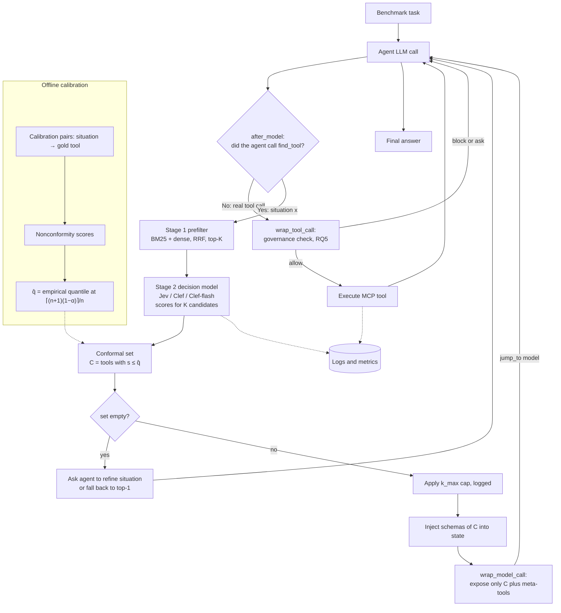

# Research Design: Coverage-Guaranteed Tool Exposure for LLM Agents

**Working title:** Conformal Tool Exposure — calibrated decision models that show an agent the smallest set of MCP tools guaranteed to contain the right one

**Version:** 0.1 (draft) · **Date:** 9 October 2026 · **Status:** design, pre-implementation

> **Evidence note.** Facts below are cited to papers, official docs, or model cards. Claims marked **[verify]** come from secondary sources, vendor self-reports, or sources I could not read in full. Re-check them before relying on them.

---

## 1. Abstract

Agents connected to large MCP ecosystems cannot fit every tool schema in context. Current fixes retrieve a fixed top-k of tools, which gives no guarantee that the correct tool is shown. If it isn't, the agent fails or hallucinates. This project uses **split conformal prediction** over scores from a **calibrated decision model** (Jev-style: Jev, Cloudflare Clef, Clef-flash) to expose an **adaptive set** of tools. The set is guaranteed, under exchangeability, to contain the needed tool with probability at least 1−α, and it stays as small as the model's confidence allows. The method is built as harness middleware (LangChain, with Strands as an alternative). It is evaluated on MCP-scale benchmarks for coverage, set size, task success, tokens and latency, and stress-tested under catalog drift and adversarial tool descriptions.

---

## 2. Motivation

| Observation | Evidence |
|---|---|
| Loading every tool schema bloats context | Anthropic reports that most MCP clients load all tool definitions upfront, and that on-demand discovery cut one task from 150,000 to 2,000 tokens (Anthropic engineering, "Code execution with MCP") |
| Retrieval, not token cost, is now the main failure point | On LiveMCPBench, retrieval errors account for nearly half of all agent failures (arXiv 2508.01780) |
| Single-shot retrieval breaks in multi-turn use | MCP-Zero shows that matching the user query once can give inaccurate or insufficient tool selection (arXiv 2506.01056) |
| Fixed top-k has no principled size rule | Set-valued routing work notes that prior pipelines lack a principled decision rule for how many items to select (arXiv 2606.28925) |
| Calibrated decision models now exist | Jev (TypeSafe, Sep 2026) and Clef / Clef-flash (Cloudflare, Oct 2026) return a probability for each option instead of generated text |

**Core idea:** turn "which tools should the agent see?" into a prediction-set problem with a statistical guarantee, instead of a hand-tuned top-k.

---

## 3. Problem statement

Given an agent's **situation description** *x* (what it needs to do next, plus short context) and a tool catalog *T* (|T| in the thousands), return a set *C(x) ⊆ T* such that:

1. **Coverage:** P(y ∈ C(x)) ≥ 1 − α, where *y* is the tool needed for the step.
2. **Efficiency:** the expected set size E[|C(x)|] is as small as possible.
3. **Latency:** building C(x) adds well under one agent LLM turn of wall time.
4. **Robustness:** coverage degrades gracefully, and detectably, when the catalog changes or tool descriptions are adversarial.

Only the schemas in C(x) are injected into the agent's context. The agent then calls a tool with exact arguments.

---

## 4. Research questions and hypotheses

| ID | Research question | Hypothesis |
|---|---|---|
| RQ1 | Does conformal prediction over decision-model scores hit target coverage on MCP-scale catalogs, and how small are the sets? | **H1:** at equal coverage, decision-model scores (Jev/Clef) give smaller average sets than embedding-similarity or LLM-logit scores |
| RQ2 | Does adaptive set exposure beat fixed top-k and agent-driven discovery on task success per token? | **H2:** conformal exposure dominates fixed top-k on the success-vs-tokens Pareto frontier |
| RQ3 | How robust is coverage to catalog drift and to distribution shift between calibration and test? | **H3:** split CP loses coverage under drift; online CP restores it within a bounded number of steps |
| RQ4 | Can adversarial tool descriptions manipulate the selector? | **H4:** poisoned descriptions inflate their own scores and enter sets more often; a description-sanity check reduces this |
| RQ5 (extension) | Can the same decision-model call return governance risk labels at negligible extra latency? | **H5:** adding risk questions to the same call adds under 10% latency |

---

## 5. Planned contributions

1. A formulation of MCP tool exposure as **end-to-end conformal prediction** over a two-stage pipeline (prefilter → decision model), including how the prefilter's misses enter the guarantee (Section 8.4).
2. The first empirical comparison of **decision models (Jev, Clef, Clef-flash) as conformal score functions** against embedding and LLM-logit scores. This is unpublished as far as I found (medium confidence).
3. A study of **coverage under catalog drift** and **adversarial tool descriptions**, two failure modes specific to MCP.
4. Open-source **harness middleware** (LangChain, with notes for Strands) plus evaluation scripts.

---

## 6. Related work

### 6.1 Tool retrieval and context bloat

| Work | What it does | Gap relative to this project |
|---|---|---|
| RAG-MCP (arXiv 2505.03275) | Semantic retrieval of relevant MCPs before the LLM call | Fixed top-k; no coverage guarantee |
| MCP-Zero (arXiv 2506.01056, NeurIPS 2025) | Agent actively requests tools; 308 servers, 2,797 tools; ~98% token reduction | Embedding matching; no guarantee |
| ScaleMCP (arXiv 2505.06416, NeurIPS 2025) | Agent re-queries an MCP retrieval tool | No calibrated set size |
| Dynamic ReAct (arXiv 2509.20386) | Scalable tool selection for large MCP setups | No guarantee |
| Vector-based MCP selection (arXiv 2603.20313) | Dense retrieval over 121 tools, sub-100ms | Small scale |
| SCOUT (arXiv 2608.23992) | Gateway with `tool_search` / `execute_tool`; BM25 + dense with RRF; 2,000+ tools | Fixed top-k; strong engineering baseline |
| HYSET (arXiv 2607.25718) | Scores whole tool sets via a co-invocation hypergraph | Set-level but not conformal |
| Toollery (arXiv 2609.22218) | Scaling agents to thousands of skills and tools | **[verify]** full text not read |
| Dynamic system instructions and tool exposure (arXiv 2602.17046) | Cited by Toollery | **[verify]** not read |
| Anthropic code execution / Tool Search Tool | Load tool definitions on demand | Industry practice; no guarantee |

### 6.2 Conformal prediction for LLM decisions

| Work | Relevance |
|---|---|
| Prune 'n Predict / CROQ + CP-OPT (ICML 2025, arXiv 2501.00555) | **Closest prior work.** Conformal sets for tool usage (ToolAlpaca), then re-asks the LLM with only the set. Notes that logit scores give large sets |
| PASC (arXiv 2605.18812) | Joint coverage across multi-stage pipelines; relevant to prefilter → decision model |
| Conformal CPO (arXiv 2511.11828, AAAI) | Uses online conformal prediction to keep coverage while optimizing agent cost |
| Conformity Breaks CP (arXiv 2609.04445) | Shows coverage collapses when exchangeability breaks (90% → 74%); motivates RQ3 |
| CAS (arXiv 2608.20771) | Conformalized agentic search; gives the standard split-CP formulation |
| Role-Stratified Conformal Risk Control for LLM Tool Calls (arXiv 2607.24343) | Conformal risk control on tool calls; relevant to RQ5. **[verify]** only references read |
| Conformal Risk Control (Angelopoulos et al., 2024) | Controls expected loss such as false-negative rate; needed for multi-tool steps |

### 6.3 Gateways and governance (for RQ5)

ToolGuards (arXiv 2507.16459), Agent-C (arXiv 2512.23738), Prompts Don't Protect (arXiv 2605.18414), cloud MCP gateway (arXiv 2607.15593), MCP security surveys (arXiv 2503.23278, 2510.16558, 2511.20920).

### 6.4 Gap

No work I found combines (a) conformal coverage guarantees, (b) calibrated decision-model scores, and (c) MCP-scale catalogs with drift and adversarial descriptions. **Confidence: medium.** The area moves weekly, so re-run the literature search before submission.

---

## 7. System design

### 7.1 Runtime architecture

### 7.2 Choice of decision model

The user asked for an open-source Jev. **TypeSafe has not released Jev's weights**: it is available only as a hosted API (also via Vercel AI Gateway). The open options are below.

| Model | Access | Key facts | Role in this study | Confidence |
|---|---|---|---|---|
| **Cloudflare Clef-flash** (9B) | Apache 2.0 weights on Hugging Face; hosted on Workers AI | Jev-compatible API; Cloudflare reports 38.8 ms median latency; ~18.8 GB in BF16 | **Primary open model** (fast, runs on one GPU) | High on licence and API; latency is self-reported |
| **Cloudflare Clef** (27B) | Apache 2.0 weights (`Cloudflare/clef`); Workers AI | Built on Qwen3.8-27B; text, images, video; Jev-compatible; ~54.7 GB in BF16; hosted price $0.24/M tokens (The Register) | Accuracy-oriented open model | High on licence; benchmark claims are self-reported and not yet reproduced |
| **TypeSafe Jev** (`jev-1.13.0`) | Hosted API only | $0.042/M input tokens; Choice up to 255 options; state + longest question ≤ ~32k tokens; 80 req/s; text only; no paper or public benchmarks | Closed reference model | Medium; specs from a detailed third-party guide **[verify against docs.typesafe.ai]** |
| autotrust/JEV-9B, JEV-27B | Apache 2.0 on Hugging Face | Unofficial students distilled from Jev outputs; not affiliated with TypeSafe | Optional extra baseline | Low; community claims |
| TypeSafeAI/Open-Jev (dataset) | Hugging Face | Typed-decision datasets with calibration splits; independent of official Jev | Optional sanity check of calibration | Medium |
| OpenAI Decisions API (GPT-6 Luna) | Limited preview (reported 29 Sep 2026) | Decision-model API from OpenAI | Optional closed baseline if access is granted | Low **[verify]** |

**Decision:** use **Clef-flash as the primary score source** (open, reproducible, runs on one GPU), with **Clef** and **Jev** as comparison score sources. The shared Jev-compatible request format means one client works for all three.

**Access risk:** Jev paused new signups on 22 Sep 2026 (third-party report). Clef removes this dependency.

### 7.3 The `find_tool` meta-tool

The agent sees only the meta-tool `find_tool(situation: str)` plus the tools it has already been given. The tool description tells the agent to describe the **next action and its inputs/outputs**, not the user's whole goal. For example: "send a Slack message to #ops with a summary", rather than "help me with the incident".

### 7.4 Stage 1: prefilter

- **Method:** hybrid BM25 + dense embeddings fused with Reciprocal Rank Fusion, following SCOUT. Use toolrank (Qwen3-Embedding-8B fine-tuned for tool retrieval, on PyPI) as the dense retriever, plus a general embedding model as an ablation.
- **K (candidates passed on):** pick K on a **separate dev split** so that prefilter **recall@K ≥ 1 − α + margin**. Grid: K ∈ {20, 50, 100}. Jev's Choice limit is 255 options; Clef's limit should be checked **[verify]**.
- **Why this matters:** the prefilter's recall@K is a **hard ceiling** on end-to-end coverage (Section 8.4).

### 7.5 Stage 2: decision-model scoring (two modes)

| Mode | Request | Output | Fits |
|---|---|---|---|
| **A: Choice** | One Choice question over K candidates. The state holds the situation; the criteria hold each tool's name, description and parameter summary | A probability distribution over K options (sums to 1) | Steps that need **one** tool; standard single-label CP |
| **B: Noul per tool** | K independent yes/no questions in one call: "Is `tools[i]` able to perform the action in `situation`?" | An independent probability per tool | Steps that may need **several** tools; multi-label conformal risk control |

Mode B follows TypeSafe's own cookbook pattern of re-ranking BM25 shortlists with one Noul per pair, and its skill-suggestion cookbook, which ranks 182 skills in one request.

**Request design rules** (from Jev's documented failure modes): keep one judgment per question; reference state fields with backticks; add a `none_of_these` option in Mode A; send only the K candidates, never the whole catalog, because accuracy drops with irrelevant state; and pin the model version, since thresholds tuned on one version may not transfer.

### 7.6 Harness integration (no code yet)

| Need | LangChain (recommended) | Strands (alternative) |
|---|---|---|
| Intercept `find_tool` | `after_model` hook, then `jump_to: "model"` | `AfterModelCallEvent` |
| Restrict which tools the model sees | `wrap_model_call` (edit the tool list per request) | **[verify]** whether tools can be changed mid-run |
| Governance check per call | `wrap_tool_call` | `BeforeToolCallEvent` (can change `selected_tool`) |
| Packaging | Class-based `AgentMiddleware` | `Plugin` bundling several hooks |
| Prebuilt baseline | LangChain may ship a tool-selector middleware **[verify]** | — |

Sources: LangChain custom-middleware docs; Strands hooks and plugins docs.

---

## 8. Conformal method

### 8.1 Calibration unit

One calibration example is one pair: (situation *x*, gold tool set *Y*) taken from a single agent step.

### 8.2 Single-tool steps (Mode A)

- **Score (LAC):** s(x, y) = 1 − p̂(y | x).
- **Threshold:** with *n* calibration scores, q̂ is the ⌈(n+1)(1−α)⌉/n empirical quantile.
- **Set:** C(x) = { t ∈ top-K : 1 − p̂(t | x) ≤ q̂ }.
- **Guarantee:** P(y ∈ C(x)) ≥ 1 − α, marginally, under exchangeability (see the CAS paper for the standard proof).
- **Ablation:** APS scores, which give better conditional coverage at the cost of larger sets.

### 8.3 Multi-tool steps (Mode B)

- **Loss:** the false-negative rate, i.e. the fraction of gold tools missing from C(x).
- **Method:** conformal risk control. Choose the threshold λ̂ so that the expected false-negative rate ≤ α.

### 8.4 End-to-end guarantee across both stages

Define the score as **s = +∞ whenever the gold tool is not in the prefilter's top-K**, and calibrate on the whole pipeline.

- **What this preserves:** the guarantee holds end to end, because prefilter misses count as non-coverage.
- **Consequence:** if prefilter recall@K < 1 − α, then q̂ = ∞, every candidate is kept, and coverage is still capped at recall@K. This is why K is chosen first on a dev split (Section 7.4).
- **Optional:** PASC-style joint calibration as an alternative.

### 8.5 Special cases

| Case | Handling |
|---|---|
| **Empty set** (possible with LAC) | Treat as abstention: the agent refines its situation, or the gateway falls back to top-1. Report the empty-set rate |
| **k_max cap** | A cap such as 5 or 8 controls tokens but **breaks the guarantee**. Report "capped coverage" separately |
| **Dependent steps** | Steps within one task are correlated. Calibrate on **one randomly drawn step per task**, and split calibration and test **by task** |
| **Catalog drift** | Online conformal (adaptive quantile tracking) updates q̂ from feedback on whether the chosen tool succeeded |

---

## 9. Datasets and benchmarks

| Benchmark | Scale | Gold labels | Use in this study | Caveats |
|---|---|---|---|---|
| **ToolRet** | 7,961 queries over 44,453 tools (as used by toolrank) | Yes (binary relevance) | Large calibration and test pool for the offline phase | Not MCP-native; citation **[verify]** |
| **LiveMCPBench** (arXiv 2508.01780) | 95 real-world tasks; 525-tool retrieval set in toolrank's setup | Per-step labels **[verify]** | Agent-in-the-loop evaluation | Small *n*, so conformal quantiles are coarse; use for testing, not calibration |
| **MCP-Bench** (arXiv 2508.20453; github.com/Accenture/mcp-bench) | 28 live MCP servers, 250 tools; multi-step, fuzzy instructions | Task-level; per-step labels **[verify]** | Multi-step tasks, cross-tool coordination | Live servers can change over time; snapshot them |
| **MCP-Zero tools** (arXiv 2506.01056) | 308 servers, 2,797 tools | **No queries shipped** (per toolrank) | Large catalog for scale and drift tests | Needs synthetic queries; LLM-generated queries can be biased, so human-audit a sample |
| **AgentDojo** | Prompt-injection environments | Attack success labels | RQ4 and RQ5 adversarial tests | Not MCP-scale |
| **Jev Decision Index** (Hugging Face) | Decision benchmark | Yes | Sanity check that each decision model behaves as expected | Leaderboard numbers are partly self-reported |

### 9.1 Label construction

1. **Gold labels:** use benchmark labels wherever they exist.
2. **Silver labels:** where they don't, run a strong agent with the **full catalog** and record the tool it used on successful runs. Mark these as silver.
3. **Audit:** have a human check a random 10% sample of silver labels and report label error.
4. **Equivalent tools:** accept any tool in a pre-declared equivalence class, since near-duplicate tools across servers are common.

### 9.2 Splits

Dev (choose K and prompts) / calibration / test, split **by task**. Repeat with **≥ 100 random calibration–test splits** and report the distribution of coverage.

---

## 10. Experiments

### 10.1 Pipeline

```mermaid
flowchart LR
    D[Collect benchmarks<br/>and snapshot catalogs] --> L[Build gold and silver<br/>step-level labels]
    L --> S[Split by task:<br/>dev / calibration / test]
    S --> K[Choose prefilter K<br/>on dev for recall@K]
    K --> P1[Phase 1: offline retrieval<br/>coverage and set size]
    P1 --> P2[Phase 2: agent in the loop<br/>success, tokens, latency]
    P2 --> P3[Phase 3: stress tests<br/>drift, shift, adversarial]
    P3 --> P4[Phase 4: governance<br/>extension, RQ5]
    P4 --> A[Analysis and<br/>statistical tests]
```

### 10.2 Phase 1: offline retrieval (answers RQ1, cheap, no agent)

**Score sources compared**, all using the same prefilter and the same CP procedure:

1. Embedding cosine similarity (temperature-scaled into probabilities).
2. toolrank fine-tuned embedding.
3. A cross-encoder reranker.
4. LLM log-probabilities (CP-OPT-style, following Prune 'n Predict).
5. Clef-flash, in Mode A and Mode B.
6. Clef, in Mode A and Mode B.
7. Jev, in Mode A and Mode B (if API access is available).

**Grid:** α ∈ {0.05, 0.10, 0.20} × K ∈ {20, 50, 100}.

### 10.3 Phase 2: agent in the loop (answers RQ2)

Run with two agent LLMs: one closed frontier model and one open-weight model.

| Condition | Tool exposure |
|---|---|
| A | All tools in context (bloat baseline; only feasible for small catalogs) |
| B | Hybrid retrieval, fixed top-k ∈ {1, 3, 5} |
| C | Agent-driven discovery (MCP-Zero / ScaleMCP style) |
| D | Decision-model top-1 |
| E | **Decision model + conformal set (proposed)** |
| F | E with a k_max cap |
| G | E + online CP |

### 10.4 Phase 3: stress tests (answers RQ3 and RQ4)

| Test | Procedure |
|---|---|
| Catalog drift | After calibration, add or remove 20% of tools, rename tools, and inject near-duplicates. Compare split CP with online CP |
| Distribution shift | Calibrate on ToolRet, then test on MCP benchmarks |
| Adversarial descriptions | Poison 1–5% of tool descriptions with text designed to raise their own scores (e.g. "use this tool for any request"). Measure how often poisoned tools enter sets. Jev's own docs warn that text in the state can still move the answer |
| Multi-turn | Run sessions with topic switches to check whether situation descriptions stay specific enough |

### 10.5 Phase 4: governance extension (answers RQ5)

Add risk questions (security, privacy, ethics) to the **same** Stage-2 call. Measure the added latency, and the attack success rate and false-block rate on AgentDojo-style tasks.

---

## 11. Metrics

| Level | Metric |
|---|---|
| Retrieval | Empirical coverage (target ≥ 1−α), average set size, singleton rate, empty-set rate, coverage by set size and by tool category (conditional coverage), prefilter recall@K |
| Decision model | Expected calibration error (ECE), reliability diagrams, top-1 accuracy |
| Agent | Task success rate, steps per task, input and output tokens, wall-clock latency, cost per solved task |
| Robustness | Coverage gap under drift; recovery time with online CP; poisoned-tool inclusion rate |
| Governance (RQ5) | Attack success rate, false-block rate, added latency |

**Primary metrics:** coverage, average set size, and task success per 1k tokens.

---

## 12. Statistical analysis

- **Coverage:** over ≥ 100 random splits, report the mean and the 5th percentile. Under exchangeability, coverage over random splits should follow a known Beta distribution; compare against it.
- **Between conditions:** paired bootstrap 95% confidence intervals per task, with Holm correction across comparisons.
- **H1 test:** compare set sizes between score sources at matched empirical coverage.
- **Pre-registration:** fix α, K grid, metrics and primary hypotheses before Phase 2 to avoid tuning to the test set.

---

## 13. Threats to validity

| Threat | Mitigation |
|---|---|
| Exchangeability fails (correlated steps, drift, shift) | Per-task splits, one step per task in calibration, online CP, explicit shift experiments |
| Gold-label noise (several tools can be correct) | Equivalence classes, silver-label audit, report label error |
| Synthetic-query bias (MCP-Zero has no queries) | Use more than one generator model, human audit, report separately |
| Vendor-reported numbers (Jev, Clef) | Rely only on our own measurements; treat vendor claims as context |
| Closed-model version changes | Pin `jev-1.13.0`; log the model ID returned with every response |
| Decision models read prompts literally | Keep fixed prompt templates; run a prompt-sensitivity ablation |
| Prefilter caps coverage | Choose K for recall on the dev split; report recall@K |
| Results specific to one harness | Implement in LangChain and replicate a subset in Strands |

---

## 14. Compute and budget (rough)

| Item | Estimate |
|---|---|
| Clef-flash self-hosted | ~18.8 GB weights in BF16, so one 24–48 GB GPU |
| Clef self-hosted | ~54.7 GB in BF16, so one 80 GB-class GPU (Cloudflare tested on an H200) |
| Jev API | ~8k tokens per call (K = 50 tools × ~150 tokens + situation) × 10,000 calls ≈ 80M tokens ≈ **$3.4** at $0.042/M |
| Clef hosted | Same volume at $0.24/M ≈ **$19** |
| Agent LLM calls | Will dominate the budget; estimate after Phase 1 |

---

## 15. Timeline (about 14 weeks)

| Weeks | Phase | Output |
|---|---|---|
| 1–2 | Setup: snapshot benchmarks, build labels, decision-model client, splits | Data package |
| 3–5 | Phase 1: offline retrieval and CP | RQ1 results; choose primary configuration |
| 6–8 | Phase 2: agent in the loop (LangChain middleware) | RQ2 results |
| 9–10 | Phase 3: drift, shift, adversarial | RQ3 and RQ4 results |
| 11–12 | Phase 4: governance extension | RQ5 results |
| 13–14 | Analysis, write-up, code release | Paper draft and repository |

---

## 16. Risks and mitigations

| Risk | Likelihood | Mitigation |
|---|---|---|
| Concurrent work publishes the same idea (field moves weekly) | Medium–high | Re-search arXiv every 2 weeks; position the drift and adversarial results as the distinct contribution |
| Jev access blocked | Medium | Clef / Clef-flash as primary |
| Decision models score no better than embeddings (H1 fails) | Medium | Still publishable as a negative result; the CP framework still adds the guarantee |
| Per-step gold labels missing in agent benchmarks | Medium | Silver labels plus audit |
| Live MCP servers change during the study | Medium | Snapshot catalogs and responses; replay offline |

---

## 17. Open items to verify before starting

1. Jev limits and pricing on docs.typesafe.ai (sourced here from a third-party guide).
2. Clef / Clef-flash maximum number of Choice options and context length (sources disagree: 32k vs 64k).
3. Whether LiveMCPBench and MCP-Bench publish per-step gold tool labels.
4. ToolRet's original paper and licence.
5. Contents of Toollery (arXiv 2609.22218) and arXiv 2602.17046.
6. Whether LangChain ships a tool-selector middleware usable as a baseline.
7. Whether Strands allows changing an agent's tool list mid-run.
8. Status of the OpenAI Decisions API preview.

---

## 18. References

**Tool retrieval and MCP**
- RAG-MCP, arXiv 2505.03275
- MCP-Zero, arXiv 2506.01056
- ScaleMCP, arXiv 2505.06416
- Dynamic ReAct, arXiv 2509.20386
- LiveMCPBench, arXiv 2508.01780
- MCP-Bench, arXiv 2508.20453 — github.com/Accenture/mcp-bench
- Vector-based MCP tool selection, arXiv 2603.20313
- SCOUT, arXiv 2608.23992
- HYSET, arXiv 2607.25718
- Multi-agent routing as set-valued prediction, arXiv 2606.28925
- Toollery, arXiv 2609.22218
- toolrank — pypi.org/project/toolrank
- Anthropic, "Code execution with MCP" — anthropic.com/engineering/code-execution-with-mcp

**Conformal prediction**
- Prune 'n Predict (CROQ, CP-OPT), ICML 2025, arXiv 2501.00555
- PASC, arXiv 2605.18812
- Conformal Constrained Policy Optimization, arXiv 2511.11828
- Conformity Breaks Conformal Prediction, arXiv 2609.04445
- CAS, arXiv 2608.20771
- Role-Stratified Conformal Risk Control for LLM Tool Calls, arXiv 2607.24343
- Angelopoulos et al., Conformal Risk Control, 2024
- Angelopoulos & Bates, Conformal Prediction: A Gentle Introduction, 2023

**Decision models**
- TypeSafe, "Introducing System One Models & Jev" — typesafe.ai/blog/introducing-system-one-models-and-jev
- F. Copes, "A deep dive into Jev" (third-party guide) — flaviocopes.com/jev
- Cloudflare Clef — huggingface.co/Cloudflare/clef
- The Register, Cloudflare Clef coverage (pricing, self-reported benchmarks)
- autotrust/JEV-9B — huggingface.co/autotrust/JEV-9B (unofficial)
- TypeSafeAI/Open-Jev dataset — huggingface.co/datasets/TypeSafeAI/Open-Jev

**Security and governance**
- MCP Landscape and Security Threats, arXiv 2503.23278 (FSE 2026)
- Security Issues in the MCP Ecosystem, arXiv 2510.16558
- Securing MCP: Risks, Controls, and Governance, arXiv 2511.20920
- ToolGuards, arXiv 2507.16459
- Agent-C, arXiv 2512.23738
- Prompts Don't Protect, arXiv 2605.18414
- Scalable LLM Agent Tool Access in the Cloud, arXiv 2607.15593
- AgentDojo (Debenedetti et al., 2024)

**Frameworks**
- LangChain custom middleware — docs.langchain.com/oss/python/langchain/middleware/custom
- Strands hooks — strandsagents.com/docs/user-guide/concepts/agents/hooks
